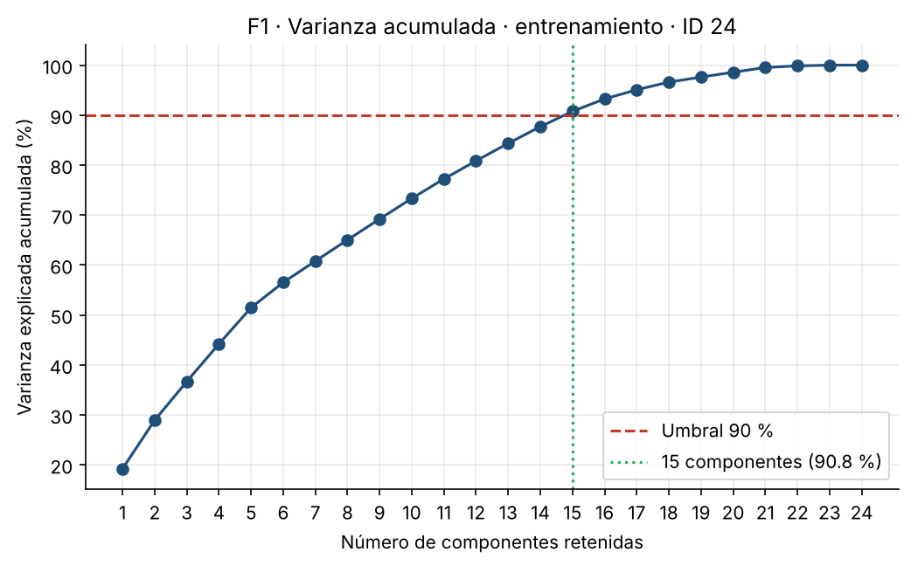
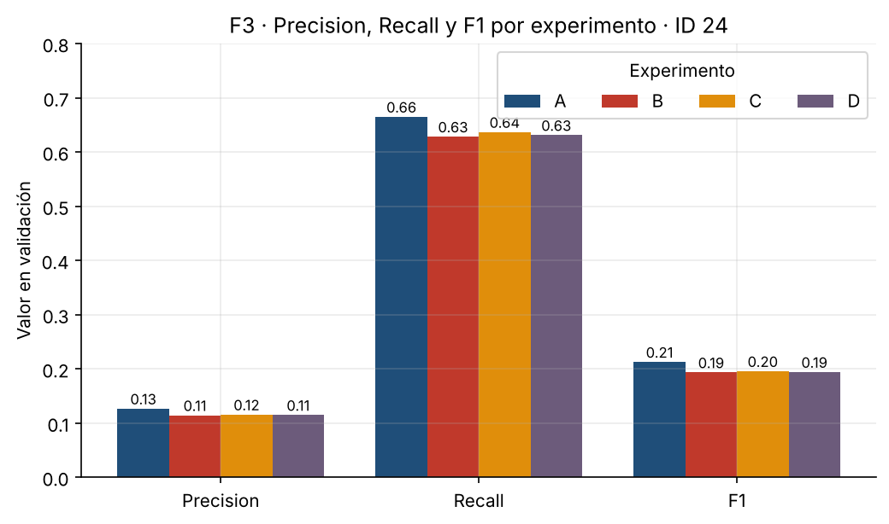
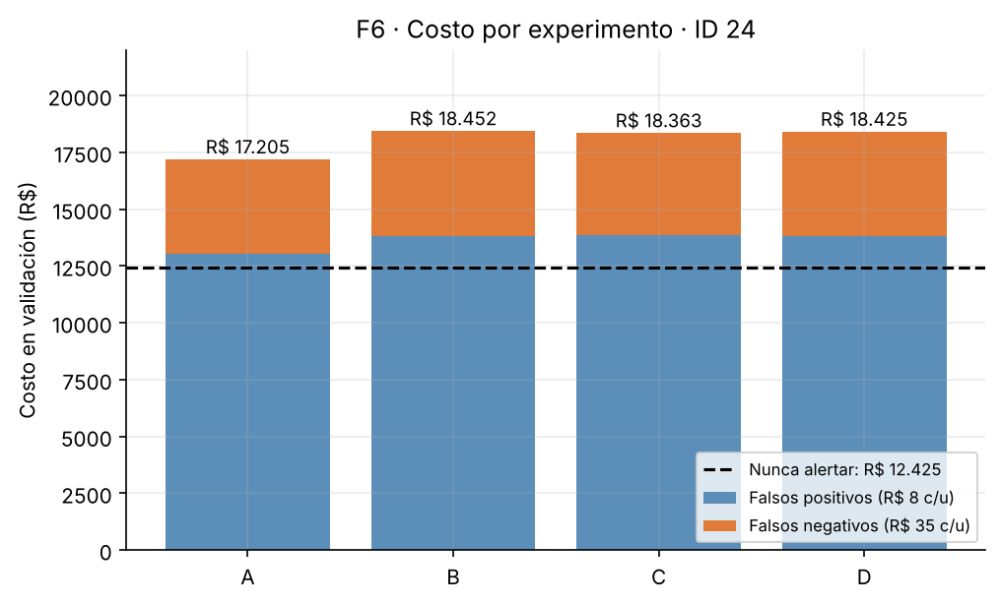
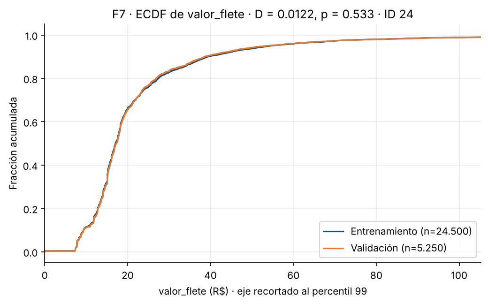
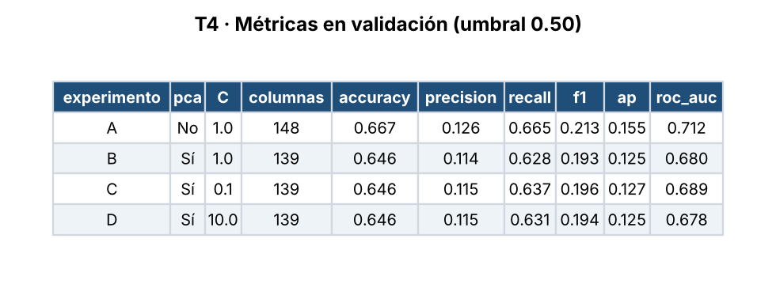
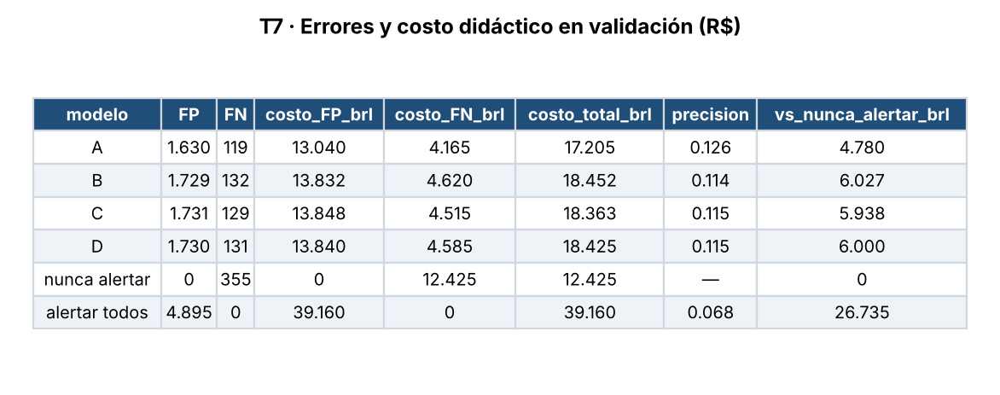

# Retrasos en entregas de Olist: ¿se pueden anticipar?

Proyecto del curso **Data Analytics ML Challenge 2026-2** · Universidad Central, Ingeniería de Sistemas
Docente: Elias Buitrago Bolivar · Autor: David Santiago Pedraza Ochoa

| Estudiante | Semilla | Huella de la muestra |
|:---:|:---:|:---:|
| ID 24 | 1024 | `89a094b75572` |

---

## 1. Planteamiento

Olist conecta vendedores y compradores en Brasil. Cada pedido trae su fecha de compra, los productos, el vendedor, el pago y la fecha de entrega prometida. Con esa información se intenta clasificar, en el momento de la compra, si el pedido llegará después de lo prometido.

El reto está en el desbalance: apenas el **6,8 %** de los pedidos se atrasa. Un clasificador que siempre diga «llegará a tiempo» obtendría cerca de 93 % de Accuracy sin detectar un solo retraso. Por eso el análisis se apoya en Recall, F1 y en un costo en reales (R$ 8 por cada falsa alarma y R$ 35 por cada retraso no detectado, valores supuestos con fines académicos).

## 2. Datos y particiones

Se trabaja con una muestra fija de **35.000 pedidos**, la misma en las semanas 12, 14 y 16.

- **Entrenamiento:** 24.500 pedidos, para ajustar cada modelo.
- **Validación:** 5.250 pedidos, para comparar y calcular costos.
- **Prueba:** 5.250 pedidos, sin usar hasta la semana 16.

## 3. Qué se hizo en cada semana

**Semana 12 · modelo base.** Regresión logística con pesos balanceados frente a un clasificador de referencia. Resultado en validación: Accuracy 0.667, Recall 0.665, F1 0.213, ROC-AUC 0.712 y costo de R$ 17.205. También se revisaron los errores por segmento.

**Semana 14 · PCA y comparación.** Se aplicó PCA solo a las 24 variables numéricas y se enfrentaron cuatro versiones del modelo cambiando una sola cosa a la vez:

| Versión | PCA | Parámetro C |
|:---:|:---:|:---:|
| A | no | 1 |
| B | sí | 1 |
| C | sí | 0,1 |
| D | sí | 10 |

Además se calculó el costo de cada una, se comparó el F1 de entrenamiento con el de validación y se aplicó la prueba de Kolmogorov-Smirnov a `valor_flete`.

## 4. Resultados

Para conservar al menos el 90 % de la varianza bastan **15 de las 24** variables numéricas (90,76 %).

La versión sin PCA (A) rinde mejor: con PCA el Recall cae de 0.665 a 0.628, se pierden 13 retrasos detectados y el costo sube en R$ 1.247 (de R$ 17.205 a R$ 18.452). Variar `C` casi no cambia nada: entre 0,1 y 10 hay dos pedidos tardíos de diferencia, y la brecha de F1 entre entrenamiento y validación es menor a 0,010, de modo que no hay sobreajuste.

Aquí aparece el problema práctico. No alertar nunca cuesta R$ 12.425, mientras que A cuesta R$ 17.205, es decir R$ 4.780 más. De las 1.866 alertas que emite, solo 236 eran retrasos reales (precisión de 0.126), por debajo del 0.186 que haría rentable alertar con estos costos.

La prueba KS no halla diferencia entre entrenamiento y validación para `valor_flete` (D = 0,0122; p = 0,533). Conviene leerla con prudencia, porque muchos importes se repiten.

## 5. Conclusión

La versión elegida es **A** (sin PCA, `C = 1`), que supera a B, C y D en todas las métricas. Aun así, con umbral 0,50 no la usaría como alarma automática, porque cuesta más que no hacer nada. Los siguientes pasos razonables son ajustar el umbral y sumar información de la ruta entre vendedor y cliente, evaluándolo siempre en validación y sin tocar la partición de prueba.

*Límites:* los costos son supuestos, no cifras reales de Olist, y todo se midió en una única partición de validación.

## 6. Contenido del repositorio

| Ruta | Descripción |
|---|---|
| `notebooks/S14_PCA_comparacion_ID_24.ipynb` | Cuaderno de la semana 14 |
| `reports/S14_reporte_ID_24.json` | Reporte completo de la semana 14 |
| `reports/S14_bitacora_experimentos_ID_24.csv` | Registro de los cuatro experimentos |
| `reports/S14_resumen_analisis_ID_24.md` | Resumen con tablas y gráficas |
| `reports/figuras/` | 10 gráficas (`S14_fig_*_ID_24.png`) |
| `reports/tablas/` | 9 tablas en CSV y PNG (`S14_tabla_*_ID_24`) |

Detalle de métricas y costos por modelo:

## 7. Cómo ejecutarlo

1. Abrir uno de los cuadernos en Google Colab o Jupyter.
2. Reiniciar el entorno y correr todas las celdas en orden. Los CSV de Olist se descargan solos desde una copia pública con revisión fija (`fa0cc6d1aff713d3c8b9a1e633b56889881848bf`).
3. El cuaderno verifica que la huella de la muestra sea `89a094b75572` y se detiene si no coincide.
4. Al terminar, se regenera toda la carpeta `reports/`.

Requisitos: Python 3, pandas, numpy, scikit-learn, scipy y matplotlib. Los datos originales no se incluyen en el repositorio.
