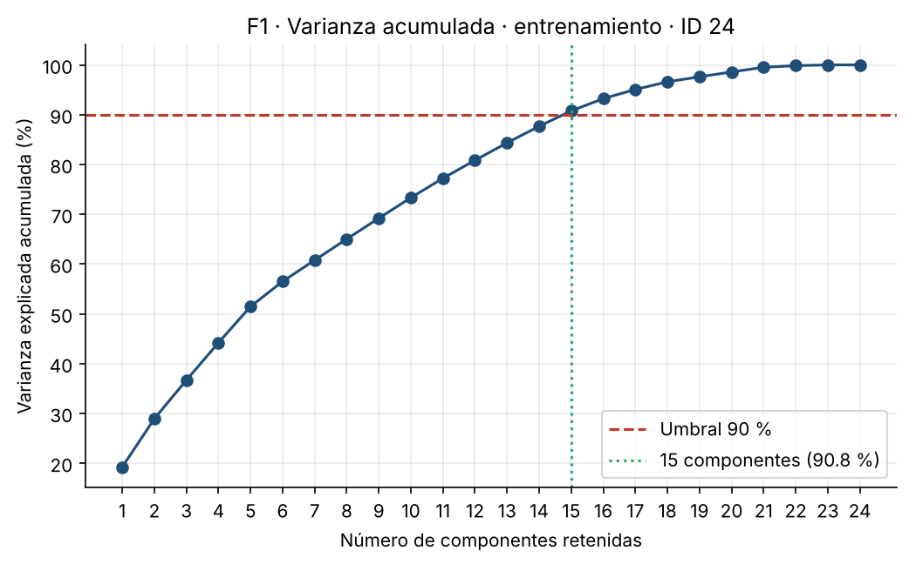
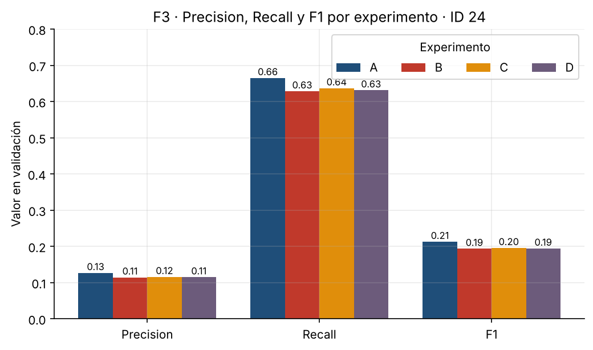
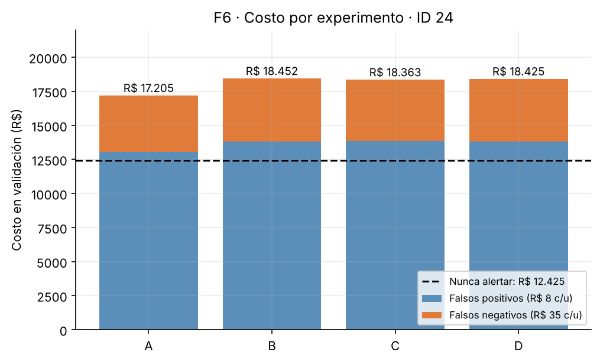
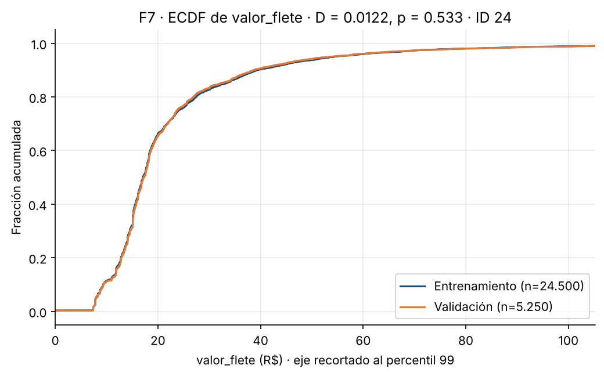

# Resumen S14 · ID 24 · PCA y evaluación de mejoras

Muestra de 35,000 pedidos (huella `89a094b75572`); validación de 5,250 pedidos con 355 tardíos.
Umbral 0.50 y `class_weight='balanced'` en todos los modelos. La prueba final no se usó.

## 1. PCA
24 variables numéricas -> **15 componentes** (90.76 % de varianza).
El clasificador recibe 139 columnas con PCA y 148 sin PCA.

## 2. Experimentos en validación
| Exp. | PCA | C | Accuracy | Precision | Recall | F1 | AP | FP | FN | Costo |
|---|---|---|---|---|---|---|---|---|---|---|
| A | No | 1.0 | 0.667 | 0.126 | 0.665 | 0.213 | 0.155 | 1.630 | 119 | R$ 17.205 |
| B | Sí | 1.0 | 0.646 | 0.114 | 0.628 | 0.193 | 0.125 | 1.729 | 132 | R$ 18.452 |
| C | Sí | 0.1 | 0.646 | 0.115 | 0.637 | 0.196 | 0.127 | 1.731 | 129 | R$ 18.363 |
| D | Sí | 10.0 | 0.646 | 0.115 | 0.631 | 0.194 | 0.125 | 1.730 | 131 | R$ 18.425 |

F1 en entrenamiento y validación: brecha máxima 0.010 (sin señal de sobreajuste).

## 3. Costo
Nunca alertar: R$ 12.425. Alertar todos: R$ 39.160.
Punto de equilibrio de precisión: 0.186; precisión de A: 0.126.

## 4. KS sobre `valor_flete`
D = 0.0122, p = 0.533 -> No rechazar H0 al 5 %. No demuestra que las distribuciones sean idénticas; hay muchos empates en los importes.

## 5. Decisión
- Modelo elegido entre A–D: **A** (menor costo y mejor en todas las métricas).
- PCA empeoró Recall, F1, AP y costo; cambiar C modificó muy poco los resultados.
- Ninguna configuración supera en costo a nunca alertar con los costos supuestos: no se recomienda operar con umbral 0.50.
- Limitaciones: costos supuestos, una sola partición de validación, sin pruebas de comparación entre modelos.
